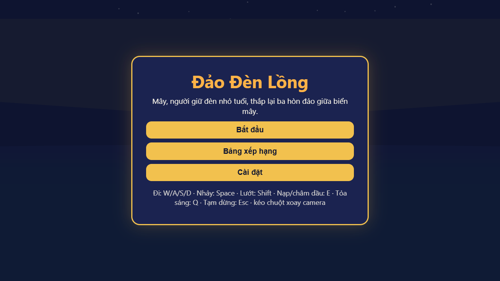
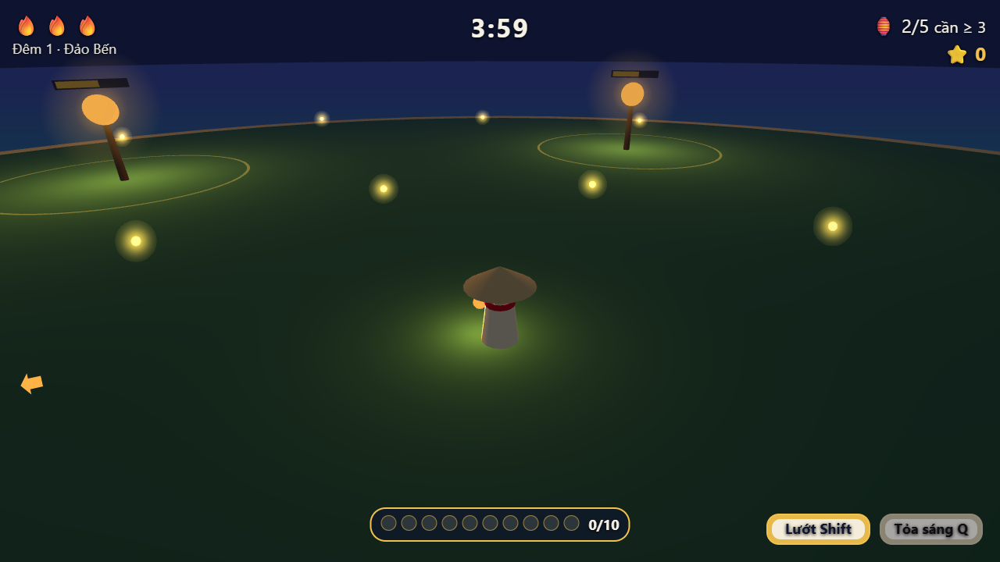
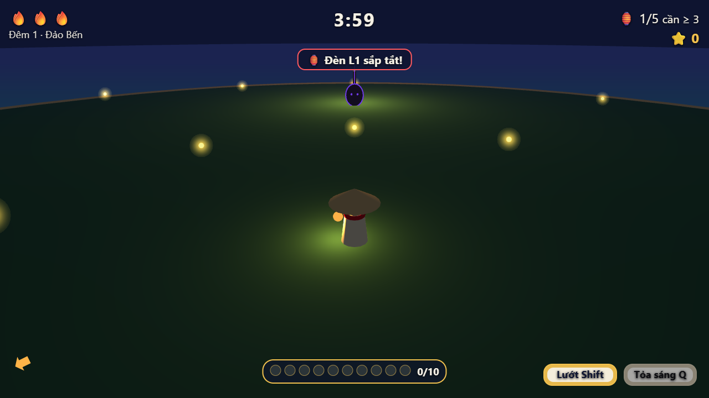
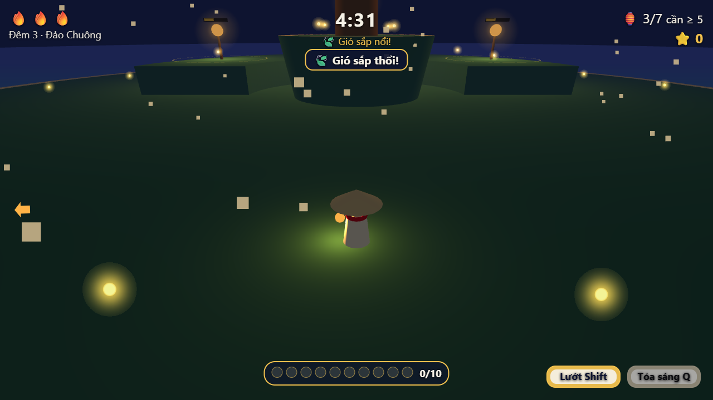
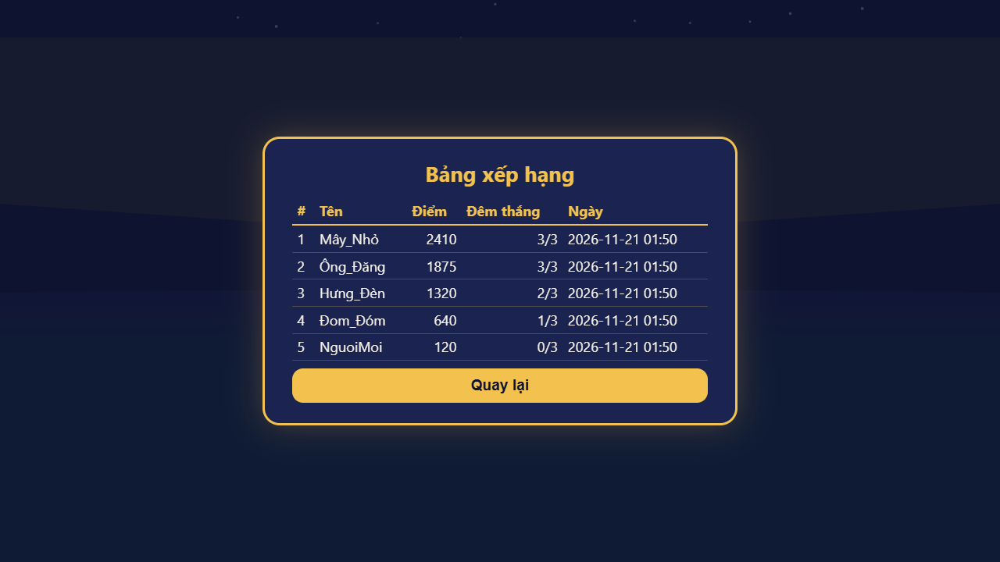
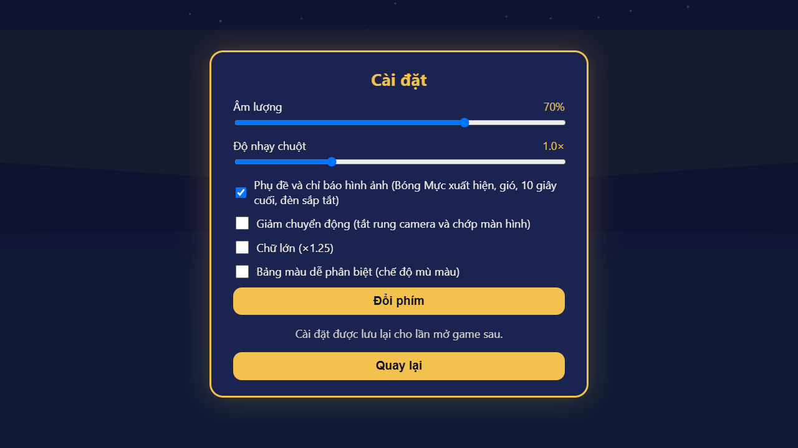
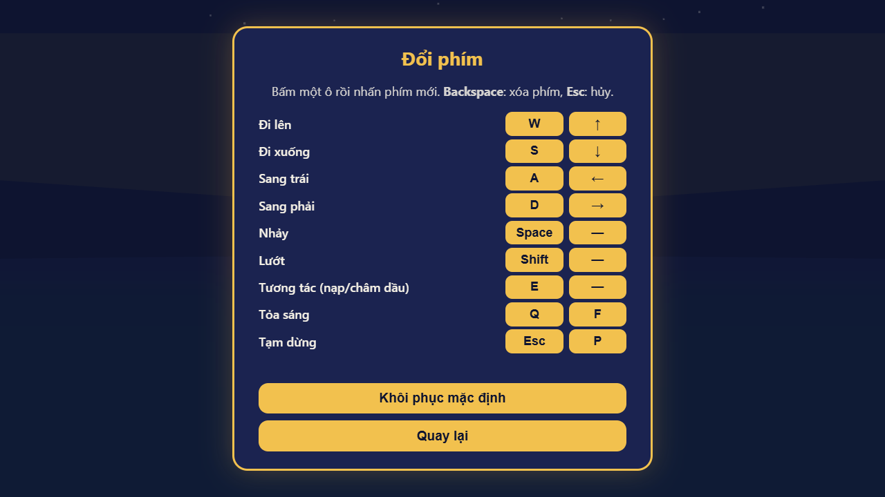

# Đảo Đèn Lồng

> **Video demo:** _chưa quay (người làm bài sẽ quay ở Checkpoint 5). Link sẽ đặt ở đây._
> Bài cá nhân Day 12 AI SDLC · MSSV 2A202603557 · Trần Thái Hưng · Tài liệu gốc của lab: [docs/LAB-README.md](docs/LAB-README.md)

Game 3D góc nhìn thứ ba. Bạn là **Mây**, người giữ đèn nhỏ tuổi (nón lá, khăn đỏ, đèn lồng nhỏ). Sương đen đã nuốt ánh sáng của ba hòn đảo. Đèn lồng thắp rồi vẫn có thể **cạn dầu và tắt**: nhiệm vụ của bạn là **giữ đảo sáng tới bình minh**, gom **đom đóm** để thắp và châm dầu, né **Bóng Mực** (chúng hút dầu đèn yếu) và **Gió Lạc**. Qua 3 Đêm: **Đảo Bến → Đảo Cau → Đảo Chuông**, rồi lưu điểm lên **bảng xếp hạng**.

| Menu | Chơi Đêm 1 | Bóng Mực hút dầu | Đêm 3, gió sắp thổi |
|---|---|---|---|
|  |  |  |  |

| Bảng xếp hạng | Cài đặt | Đổi phím |
|---|---|---|
|  |  |  |

## Yêu cầu hệ thống

- **Node.js ≥ 22** (hoặc Docker). Windows, macOS hoặc Linux.
- Trình duyệt có **WebGL** (Chrome, Edge, Firefox, Safari mới). Benchmark và bot giao diện cần **Chrome hoặc Edge**.
- Nên có GPU; màn hình 1280×720 trở lên; ~2 GB RAM trống.

## Cài đặt và chạy (3 lệnh)

```bash
git clone https://github.com/ghism137/K5-L3A-DAY12-TranThaiHung-2A202603557-AI-SDLC-Dao-Den-Long && cd K5-L3A-DAY12-TranThaiHung-2A202603557-AI-SDLC-Dao-Den-Long
npm install
npm start          # mở http://localhost:8080
```

- **Bản phát hành** (không cần git/npm): tải `dao-den-long-v1.0.0.zip` ở trang Release, giải nén, chạy `start.bat` (Windows) hoặc `./start.sh` (macOS/Linux).
- **Docker**: `docker build -t ddl . && docker run --rm -p 8080:8080 -v ddl-data:/data ddl` (volume `ddl-data` giữ bảng xếp hạng).

## Điều khiển

Mọi phím **đổi được** trong Cài đặt → Đổi phím (mỗi hành động có 2 ô; báo trùng phím; có "Khôi phục mặc định"; được lưu).

| Mặc định | Tác dụng |
|---|---|
| W A S D / mũi tên | Đi |
| Space | Nhảy (chỉ khi chạm đất) |
| Shift | Lướt 14 m/s trong 0.2 s (hồi chiêu 1.5 s) |
| E | Ở đèn chưa sáng: nạp đom đóm để thắp. Ở đèn đang sáng chưa đầy: **châm dầu** (trong 2 m) |
| Q hoặc F | Tỏa sáng: choáng và đẩy Bóng Mực trong 5 m, tốn 3 đom đóm (hồi chiêu 3 s) |
| Kéo chuột | Xoay camera (độ nhạy trong Cài đặt) |
| Esc hoặc P | Tạm dừng: Tiếp tục / Chơi lại Đêm / Cài đặt / Về menu |

## Luật chơi

- **Thắng**: còn sống khi **hết giờ (bình minh)** và số đèn đang sáng ≥ 60% tổng làm tròn lên: **3/5** (Đêm 1, 240 s), **4/6** (Đêm 2, 270 s), **5/7** (Đêm 3, 300 s). Thắp đủ đèn **không** kết thúc Đêm sớm. **Thua**: hết Ngọn Lửa, hoặc hết giờ mà thiếu đèn.
- **Nhiên liệu đèn**: đèn mới thắp đầy 100, hao 1/giây, hết dầu thì **tắt**. Châm dầu bằng E: mỗi đom đóm +10. Đèn đã từng sáng chỉ cần **5** đom đóm để thắp lại (đèn chưa từng sáng cần 10).
- **Bóng Mực hút dầu**: đèn dưới 30 dầu **mất vùng an toàn**; Bóng Mực đi tới hút 5 dầu/giây (cộng dồn). Châm dầu lên ≥ 30 thì chúng bị đẩy ra. Mây lại gần hoặc Tỏa Sáng cũng làm chúng buông đèn.
- Sức chứa đom đóm **10 + 2 × số lần thắp thành công** trong Đêm (tối đa 20). 3 Ngọn Lửa, hồi đầy đầu mỗi Đêm; Bóng Mực chạm: −1 lửa, rơi một nửa đom đóm, bất tử 1.5 s. Rơi khỏi đảo (Y < −10): −1 lửa, hồi sinh sau 1 s.
- **Gió Lạc** (Đêm 2, 3) cướp tối đa 3 đom đóm khi bạn mang ≥ 5. **Bùa Gió** (lá bùa đỏ): 10 s chạy 7.2 m/s và lướt không hồi chiêu.
- Đêm 2: hai đảo nối cầu tre, bục nhảy. Đêm 3: ba tầng, dốc, tháp chuông, gió mạnh mỗi 30 s.

| Sự kiện | Điểm |
|---|---|
| Mỗi đom đóm nạp vào đèn (thắp mới, thắp lại, châm dầu) | +5 |
| Thắp đèn lần đầu / thắp lại | +100 / +40 |
| Mỗi lần Tỏa Sáng trúng một Bóng Mực | +5 (+15 nếu nó đang hút đèn) |
| Bình minh (chỉ khi thắng): mỗi đèn sáng / mỗi Ngọn Lửa còn lại | +50 + phần nguyên của dầu / +50 |

Tổng điểm game = tổng điểm các Đêm đã thắng. Mọi con số nằm trong [game.contract.json](game.contract.json) và game đọc thẳng từ file này.

## Bảng xếp hạng

Sau màn **Bình Minh** (thắng Đêm 3) hoặc **sau khi thua ở bất kỳ Đêm nào**, bạn nhập tên (3–12 ký tự: chữ cái kể cả tiếng Việt có dấu, chữ số, `_`) để lưu điểm. Mỗi mục lưu `name`, `score`, `nights_won` (0–3), `achieved_at` (ISO 8601 có múi giờ), `seed`. Giữ **top 10**, điểm giảm dần, bằng điểm thì ai đạt trước đứng trên. Dữ liệu ghi vào file `data/leaderboard.json` (đổi thư mục bằng biến `DDL_DATA_DIR`), nên còn sau khi tắt game. Xem từ **menu chính → Bảng xếp hạng**.

```bash
npm start -- --export-leaderboard out.json    # ghi {"entries":[...]} đúng thứ tự rồi thoát (không mở cổng)
```

## Dễ tiếp cận

| Tính năng | Cách dùng |
|---|---|
| Đổi phím | Cài đặt → Đổi phím; Backspace xóa phím; Esc hủy; báo trùng phím |
| Phụ đề và chỉ báo hình ảnh | Bóng Mực xuất hiện (kèm mũi tên ở mép màn hình), gió sắp thổi, 10 giây cuối, đèn có dầu < 30 (kèm tên đèn). Tắt/bật trong Cài đặt |
| Giảm chuyển động | Tắt rung camera, chớp màn hình, nhấp nháy đồng hồ |
| Cỡ chữ | Mọi chữ giao diện ≥ 18 px ở 1280×720; "Chữ lớn" ×1.25 |
| Bảng màu dễ phân biệt | Viền Bóng Mực xanh `#00B3FF`, cảnh báo trắng kèm ⚠; đèn tắt xẹp có vết rách |

Mọi cài đặt được lưu lại cho lần mở game sau.

## Chế độ headless (Test Contract v1.3)

```bash
node src/headless/cli.js --seed 1 --night 2 --ticks 600 --out out.jsonl \
  [--scenario scenario.json] [--inputs inputs.json] [--snapshot-every 10]
```

Không cần GPU hay cửa sổ, 60 tick/giây, tất định theo seed; một Đêm đầy đủ chạy ~0.1 s. Mã thoát: 0 bình thường, 2 nếu inputs/scenario sai định dạng, 1 cho lỗi khác. Docker: `docker run --rm -v "$PWD:/out" ddl node src/headless/cli.js --seed 1 --night 3 --ticks 600 --out /out/o.jsonl`.

## Benchmark

```bash
node scripts/bench.mjs --seed 42 --duration 30 --out bench.json      # hoặc: npm run bench -- --seed 42 --duration 30 --out bench.json
```

Mở Chrome/Edge **có cửa sổ 1280×720** (tự lùi về headless nếu không mở được; thêm `--headless` để chạy máy không màn hình, `--browser <đường dẫn>` để chọn trình duyệt), nạp cảnh chuẩn `?bench=1`: Đêm 1 đầy đủ ánh sáng và hiệu ứng, **200 Bóng Mực wander rải đều** (seed 42), **100 đom đóm**, L1–L3 sáng fuel 100; tắt sinh thêm, sát thương, nhặt đom đóm, hao dầu và điều kiện kết thúc. Mây đứng yên ở (0,0,0), camera bay vòng bán kính 30 m, cao 15 m, 15 s một vòng. 3 s khởi động không đo, rồi đo đúng `--duration` giây và tự thoát mã 0. Thống kê tính đúng định nghĩa của ticket (`avg_fps`, `p1_low_fps`, `frame_ms_p95` nearest-rank, `load_ms` từ lúc tiến trình bắt đầu).

- **vsync**: trình duyệt không cho trang tự tắt vsync; script truyền cờ `--disable-gpu-vsync --disable-frame-rate-limit` (ghi `vsync_off: true`). Trên máy mà trình duyệt vẫn giới hạn theo tần số quét, số đo sẽ không vượt tần số đó.
- **`peak_mem_mb`**: tổng working set của **cả cây tiến trình trình duyệt** (gồm GPU và các tiến trình con, có phần bộ nhớ chia sẻ được tính nhiều lần nên cao hơn RSS "thật"). Lấy mẫu 2 lần ngoài cửa sổ đo (khởi động nóng và ngay sau khi đo xong) vì mỗi lần lấy mẫu tốn ~1.5 s CPU trên Windows và sẽ làm nhiễu số đo. `null` nếu hệ điều hành không cho đo.
- Số tham khảo trên máy phát triển (Windows 11, i3-1115G4, Intel UHD, 12 GB RAM, Edge 157): [docs/proof/phase4/bench.json](docs/proof/phase4/bench.json): **avg 260.6 FPS, p1 low 58.5 FPS, p95 7 ms, load 1.7 s** (ngưỡng: ≥ 60, ≥ 30, ≤ 10000 ms). Máy chấm của giảng viên có thể khác.

## Soak test

```bash
node --expose-gc scripts/soak.mjs --seed 7 --nights 10 --out soak.json    # hoặc: npm run soak -- --seed 7 --nights 10 --out soak.json
```

Chạy headless 10 Đêm liên tiếp trong **một tiến trình** (Đêm 1 → 2 → 3 xoay vòng; Đêm i dùng seed 7 + i) với input ngẫu nhiên theo seed (mỗi 30 tick đổi hướng; mỗi tick: nhảy 5%, lướt 3%, tỏa sáng 2%, tương tác 10%). `mem_start_mb` đo sau khi tải xong Đêm đầu **kèm khởi động nóng một lần** (chạy thử 900 tick trên một game bỏ đi để JIT và heap ổn định), `mem_end_mb` sau khi dựng lại Đêm cuối; cả hai là trung vị 9 mẫu RSS sau `gc()` vì một lần đọc RSS đơn lẻ dao động ±10 MB do hệ điều hành (heap V8 giữ phẳng ~5 MB). Kết quả: [docs/proof/phase4/soak.json](docs/proof/phase4/soak.json): `crashes: 0`, 39.5 → 43.3 MB (1.10×, ngưỡng 1.2×).

## Kiểm chứng

```bash
npm test                                # 154 test, chạy tuần tự (~65 s): contract v1.3, CLI, bảng xếp hạng, đổi phím, benchmark, soak, 99 scenario headless
npm run proof -- docs/proof/phaseN      # chạy CLI thật cho 99 case, lưu output + REPORT.md (sha256)
npm run mutate                          # phá cố ý 74 luật/biên; test phải bắt hết (0 sống sót)
npm run smoke                           # bot bấm phím/chuột thật trong trình duyệt: 57 kiểm tra giao diện
npm run package                         # tạo dist/dao-den-long-v1.0.0.zip
```

Bằng chứng Phase 4: [docs/proof/phase4/](docs/proof/phase4/) (`bench.json`, `soak.json`, `ui-smoke.txt`, `mutate.txt`, `regression.txt`: 99 case headless **giống hệt từng byte** so với Phase 3). Bằng chứng Phase 1–3 giữ ở `docs/proof/phase1..3` (khớp mã ở tag tương ứng). Phần **chưa kiểm tự động**: cảm nhận âm thanh, nhấp nháy, lá gió (kiểm tay), đọc bằng trình đọc màn hình (xem [cp4-checklist](docs/notes/cp4-checklist.md)).

## Sáng tạo của tôi

Chỉ có ở bản giao diện, **không đổi đầu ra headless** (cảnh benchmark tắt chúng):

- **Ông Đăng**, người dẫn truyện ở mỗi Đêm và ở Bình Minh (lời thoại do tôi viết, gợi ý mục tiêu và cơ chế của từng đảo).
- Nhạc nền đêm sinh bằng WebAudio (ngũ cung chậm), âm hiệu ứng riêng cho bùa, bị cướp, châm dầu, đèn tắt.
- Đảo sáng dần theo tiến độ, tia hút dầu nối Bóng Mực với đèn, Bóng Mực đổi sắc khi bị choáng, lá bay báo trước gió, đèn cầm tay Mây đỏ khi có Bùa Gió, thanh dầu nhấp nháy khi đèn sắp tắt.

## Harness AI

[AGENTS.md](AGENTS.md) (CLAUDE.md trỏ tới) · skill [verify-headless](.claude/skills/verify-headless/SKILL.md) và [verify-ui](.claude/skills/verify-ui/SKILL.md) · hook Stop [chặn kết thúc khi test đỏ](.claude/settings.json) · `npm run mutate` · CI [.github/workflows/ci.yml](.github/workflows/ci.yml). Ghi chép: [docs/notes/](docs/notes/) · Quyết định thiết kế: [docs/adr/](docs/adr/) · Thay đổi phá vỡ qua 4 phase: [CHANGELOG.md](CHANGELOG.md) · [Retro](docs/notes/retro.md).

Giấy phép: MIT ([LICENSE](LICENSE)). Nguồn mọi asset và công cụ AI: [CREDITS.md](CREDITS.md).